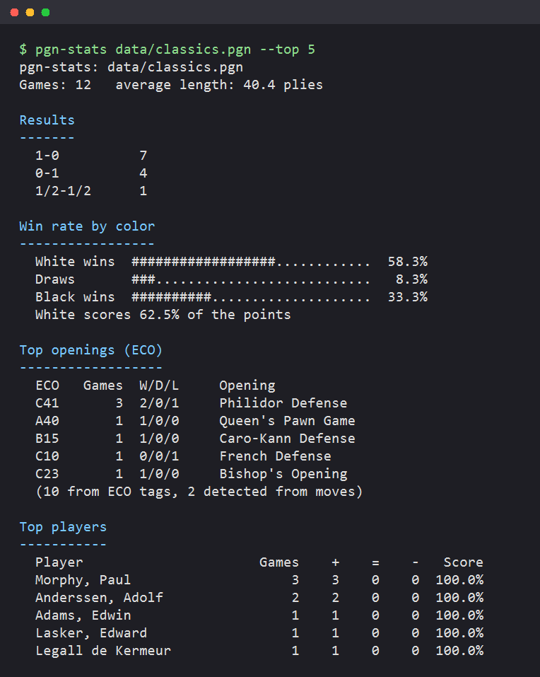

# pgn-stats

[](https://github.com/OWNER/pgn-stats/actions/workflows/ci.yml)

A fast, dependency-free C++17 command-line tool that reads a chess database in
[PGN](https://en.wikipedia.org/wiki/Portable_Game_Notation) format and reports:

- overall results and win rate by color
- the most played openings by ECO code (from tags, or detected from the moves)
- per-player records, or a detailed breakdown for one player



## Usage

```
pgn-stats <games.pgn | -> [--top N] [--player NAME]

  --top N        rows to show in the openings and players tables (default 10)
  --player NAME  show one player's record and game list instead
```

```bash
pgn-stats data/classics.pgn --top 5
pgn-stats data/classics.pgn --player morphy
cat big.pgn | pgn-stats -
```

`--player` matches case-insensitively, first on the full name and then on a
unique substring, so `--player anders` finds "Anderssen, Adolf".

## Building

Requires CMake 3.16+ and a C++17 compiler (GCC, Clang or MSVC).

```bash
cmake -S . -B build -DCMAKE_BUILD_TYPE=Release
cmake --build build --config Release
ctest --test-dir build -C Release --output-on-failure
```

The binary ends up at `build/pgn-stats` (or `build/Release/pgn-stats.exe` with
Visual Studio generators).

On Windows without Visual Studio, a MinGW-w64 toolchain works too:

```powershell
winget install BrechtSanders.WinLibs.POSIX.UCRT
winget install Kitware.CMake
cmake -S . -B build -G "MinGW Makefiles"
cmake --build build
```

## How it works

The pipeline is three small layers, each with its own tests:

| Layer | File | Notes |
|---|---|---|
| Tokenizer | [`src/tokenizer.cpp`](src/tokenizer.cpp) | Streams characters from any `std::istream` and emits PGN tokens: tag brackets, strings (with escapes), symbols, `{brace}` and `;line` comments, NAGs (`$1`, `!?`), variation parens and `%` escape lines. |
| Parser | [`src/parser.cpp`](src/parser.cpp) | Pulls one game at a time, so memory use is bounded by the largest game, not the file. Variations are tracked by depth and kept out of the main line; malformed tags and missing results are tolerated. |
| Stats | [`src/stats.cpp`](src/stats.cpp) | Aggregates results, openings and players. |

Data structures:

- **Hash maps** (`std::unordered_map`) hold per-player records and per-ECO
  counts, so each game is an O(1) update regardless of database size.
- **Sorted vectors** produce the ranked "top N" tables; ties are broken
  deterministically (score, then name / ECO code).
- **A trie of SAN moves** ([`src/opening_trie.cpp`](src/opening_trie.cpp))
  classifies games without an `ECO` tag. Walking a game's main line down the
  trie and remembering the deepest node that names an opening gives the most
  specific match in O(moves) time, e.g. `1.e4 e5 2.Nf3 Nc6 3.Bc4 Bc5 4.b4` is
  the Evans Gambit (C51) rather than just the Italian Game (C50).

## Sample data

[`data/classics.pgn`](data/classics.pgn) contains twelve well-known games from
1750-1920 (the Immortal, Evergreen and Opera games, Rotlewi-Rubinstein,
Adams-Torre and others). The game scores are historical public-domain records. Two games omit
their `ECO` tag on purpose to show opening detection.

## Project layout

```
include/pgnstats/   public headers
src/                library sources and main.cpp
tests/              doctest unit tests (run via ctest)
third_party/        vendored doctest single header (MIT)
data/               sample PGN
docs/               screenshot
```

## License

MIT, see [LICENSE](LICENSE). doctest is MIT licensed, see
[third_party/doctest/LICENSE.txt](third_party/doctest/LICENSE.txt).
